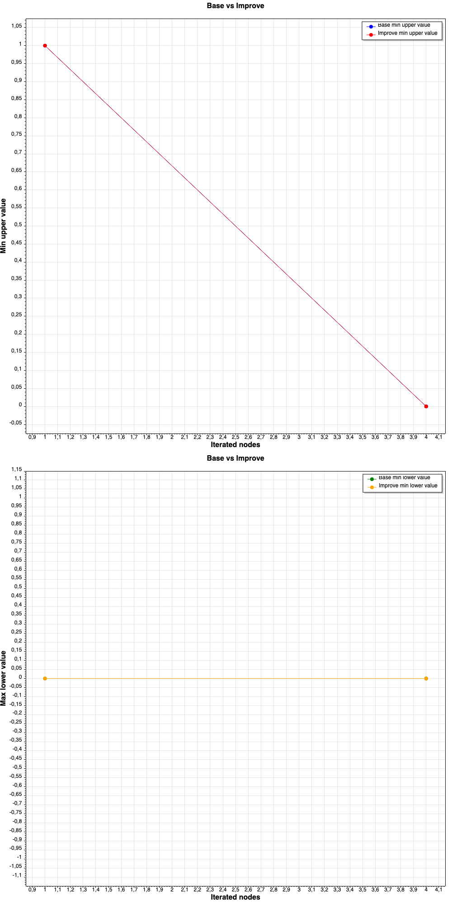
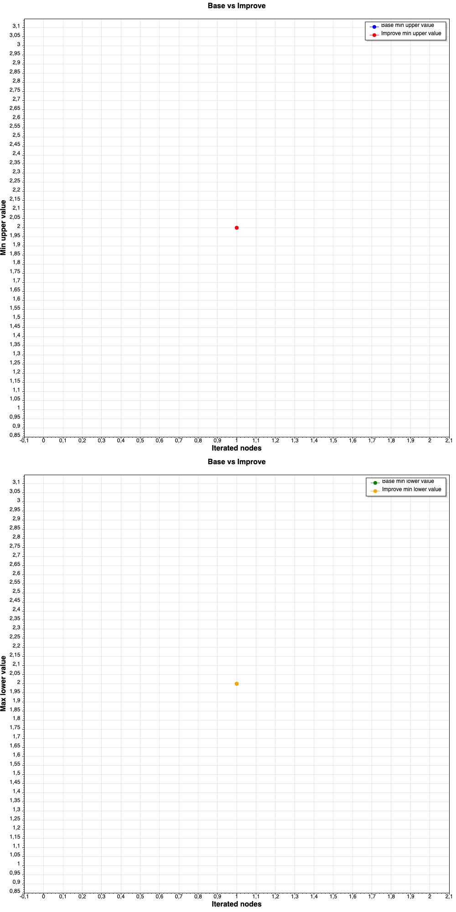
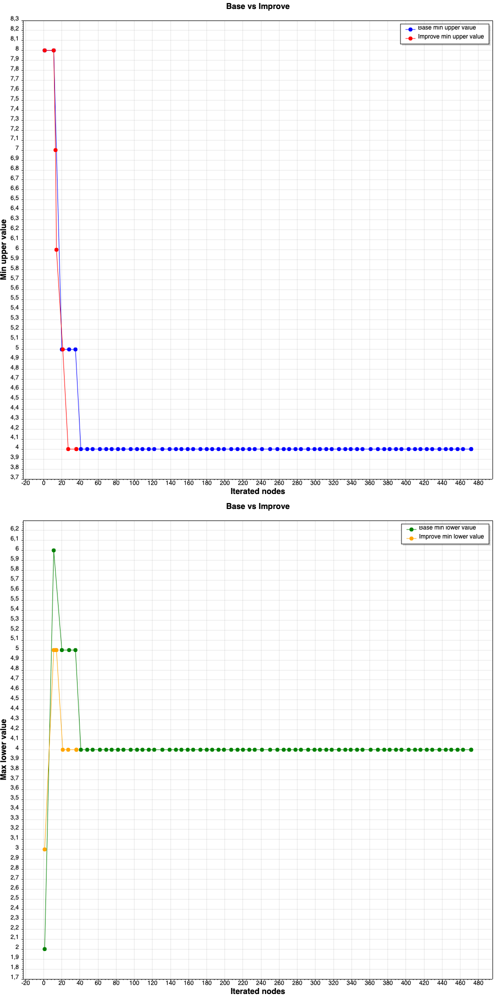
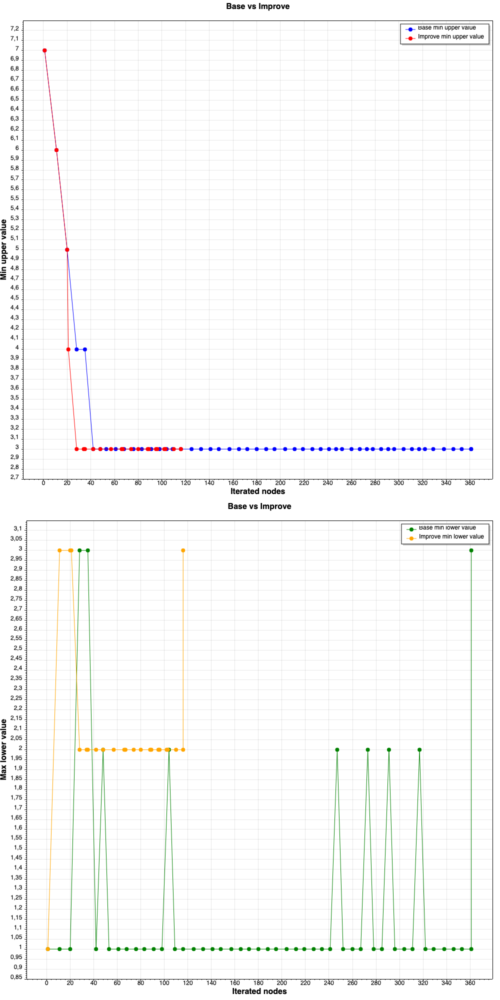
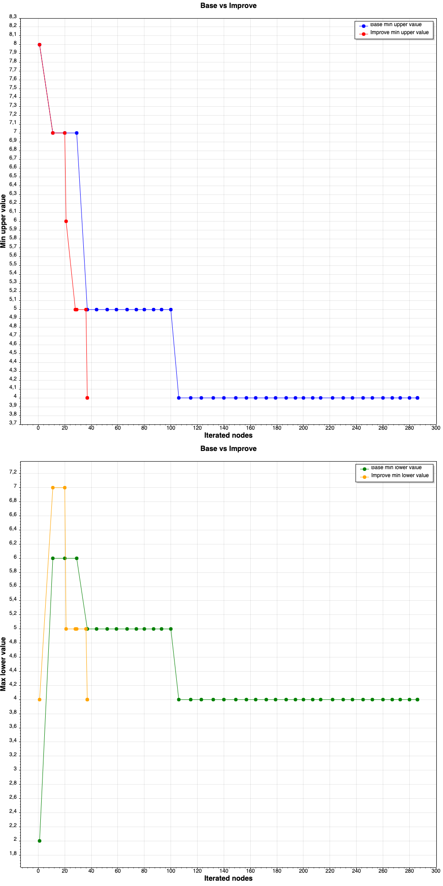
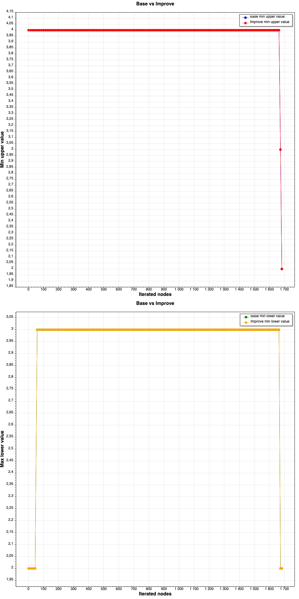
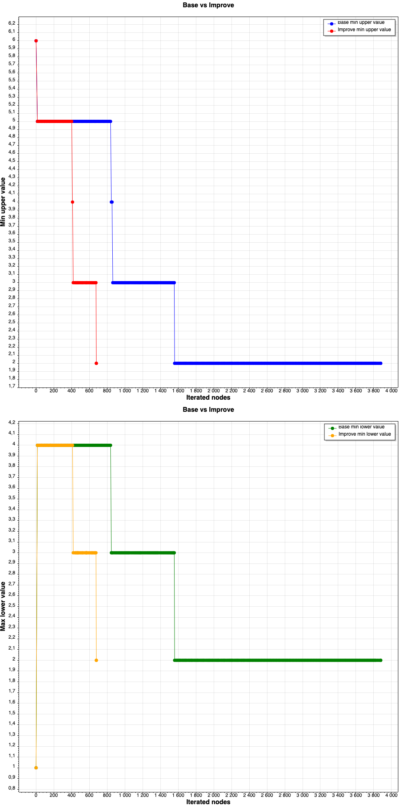
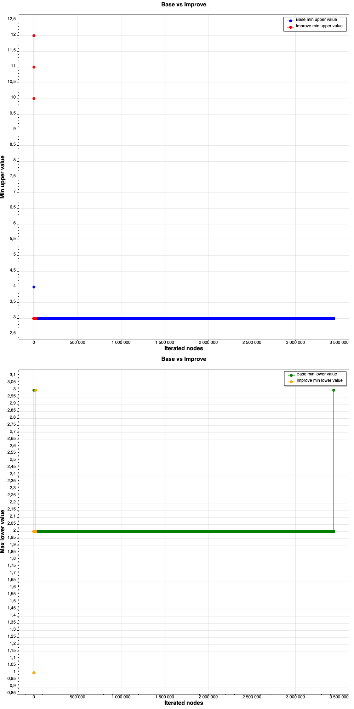
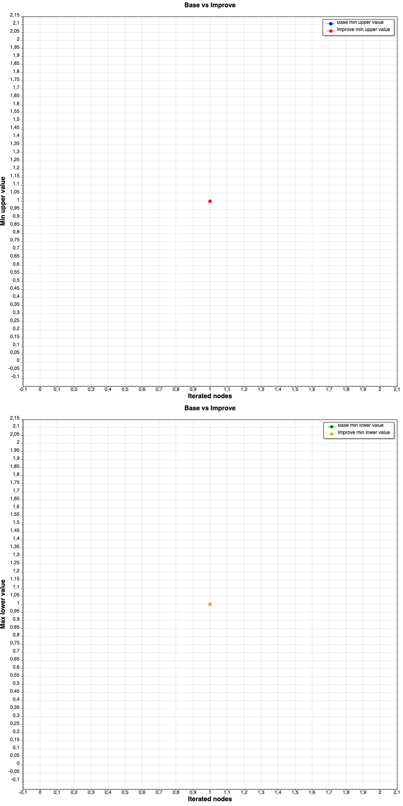
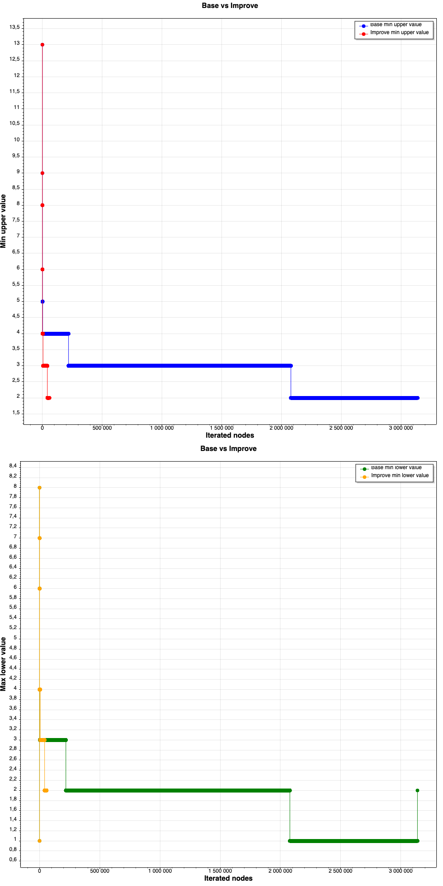

# Задача о доставке заказов
## Математическая модель
### Исходные параметры
- n - количество заказов
- t[i, j] - матрица расстояний между пункатами выдачи, i, j ∈ [1; n] \
стартуем из логистического пункта 0, далее каждый пункт соответствует какому-либо заказу (один заказ - один пункт выдачи)
- tᵈ[i] - директивный срок доставки i-ого заказа (нужно доставить в i-ый пункт выдачи) i ∈ [1, n]

### Варьируемые параметры
- π = (π1, ..., πn) - очреденость доставки, π1 доставили первым, πn - последним

### ограничения:
- t[i, j] + t[j, k] >= t[i, k] для любых i, j, k ∈ [1, n]
- t[i, j] = t[j, i] для любых i, j ∈ [1, n]
- π ∈ ∏(n) - множество всех перестановок

### Критерий
- имеем перестановку π
- t(πi) = t[0, π1] + ∑(j от 1 до i-1)(t[πj, πj+1]) - время доставки i-ого заказа (то есть единица времени совпадает с единицей расстояния)
- Z(πi) = 
    - 0, если t(πi) <= tᵈ[i]
    - 1, иначе
- Сам критерий: ∑(i от 1 до n)Z(πi) -> min \
то есть минимизируем штраф за доставку

## Алгоритм для реализации - метод ветвей и границ
### Что нужно определить
- Метод дробления
- Метод верхней оценки В
- Метод нижней оценки Н
- Стратегия обхода дерева решений (ветвление)

### Метод дробления
- π = π1, ..., πk, πk+1, ..., πn
- фиксируем первые k элементов (π1, ..., πk)
- µ1, ..., µk - постоянная часть
- πk+1, ..., πn - переменная часть
- V(µ1, ..., µk) = {π | π1 = µ1, ..., πk = µk, π ∈ ∏(n)} - подмножество перестановок с фиксирванной частью, рассматриваем такие подмножетсва при обходе

### Верхняя оценка
- µ = µ1, ..., µk - постоянная часть
- V(µ)
- Базовая стратегия - жадный алгоритм

Нужно выбрать πk+1 (затем πk+2 и т.д.) \
Пусть A - заказы которые ещё не достваили и не нарушен директивный срок \
A = {i} i ≠ µj, j ∈ [1; k], t[0, µ1] + ∑(i от 1 до k-1)t[µi, µi+1] + t[µk, i] < tᵈ[i]

i* = argmin(tᵈ[i]) i ∈ A

- Если A ≠ ø, до дополняем k+1 элементом i* 
- Если A = ø, до дополняем k+1 любым ещё недоставленным закащзом

Верхняя оценка В - считаем штраф полученной перестановки

### Нижняя оценка 
- µ = µ1, ..., µk - постоянная часть
- V(µ)

Считаем штраф фиксированной части: \
Nµ = t[0, µ1] + ∑(i от 1 до k+1)t[µi, µi+1]

D = {∂i} - заказы которые ещё не доставили i ∈ [1; n-k] \
Считаем суммарный штраф следующей доставки, если бы доставляли все заказы параллельно: \
N∂ = ∑(i от 1 до n-k)t[µk, ∂i]

Нижняя оценка Н = Nµ + N∂

### Стратегия ветвления
- Обход в ширину/глубину
- Оптимистичный способ: выбираем min(Н)
- Реалистичный способ: выбираем min(В)
- Баланс: min (В - Н)

### Реализация
1) V = {λ}, λ - пустое слово
2) Ветвление(V) -> v ∈ V 
    - V = V \ {v} \
    - v = µ1, ..., µk, ∂1, ..., ∂n-k \
    - V = V ∪ {µ1, ... , µk, ∂i | i ∈ [1, n-1]}
    - В* = min(В(v)) v ∈ V, v ≠ v* (v* = argmin(В(v)) v ∈ V)
    - V = V \ {v | v ∈ V, Н(v) >= В*} - отсечение
3) Правило остановки:
    - Если |V| = 1 и Н(v) = В(v), тогда v - оптимум
    - иначе -> шаг 2)

## Задача
### Базвый алгоритм:
- В - жадный алгоритм
- Н - параллельный алгоритм
- Ветвление - min(В)

### Собственный алгорим:
любой выбор можно менять

## Оценка эффективности
по количсеству перебираемых вершин fi для задачи i
- fᵇi - базовый алгоритм
- fᶜi - собственный алгоритм

∆i = (fᵇi - fᶜi) / fᵇi

### Критерий эффективности
mean(∆i) -> min 

### Визуалиазация
Два графика (на каждом базовый и собственный алгоритм)
1) В* от количества вершин, которое перебрали
2) max(Н) от количества вершин, которое перебрали

## Результаты
Average measure: 0,5273045698842729

### task_3_01_n3

### task_3_02_n3

### task_3_03_n10

### task_3_04_n10

### task_3_05_n10

### task_3_06_n15

### task_3_07_n15

### task_3_08_n50

### task_3_09_n50

### task_3_10_n50
